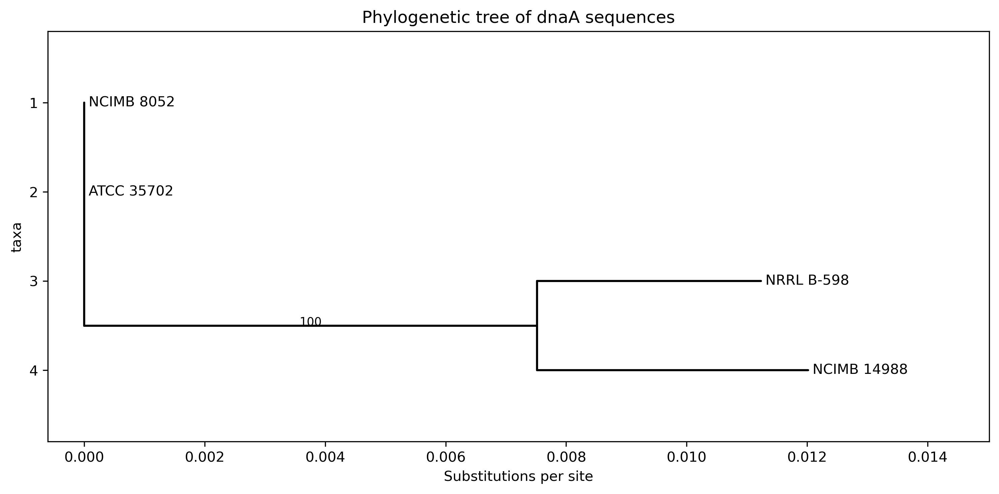

# โปรเจกต์ Bioinformatics ของ *Clostridium beijerinckii*

Repository นี้รวบรวมการฝึกใช้เครื่องมือ Bioinformatics กับแบคทีเรีย *Clostridium beijerinckii* โดยแบ่งเป็น 2 ส่วน ได้แก่

1. **BLASTN Pipeline** — ใช้ค้นหาความคล้ายคลึงของลำดับ DNA
2. **วิเคราะห์ยีน dnaA** — ใช้ MAFFT จัดเรียงลำดับ DNA และ IQ-TREE สร้าง phylogenetic tree

## 1. BLASTN Pipeline

สคริปต์ Bash สำหรับค้นหาความคล้ายคลึงของลำดับ DNA โดยใช้โปรแกรม BLAST+ จาก NCBI

### จีโนมอ้างอิง

- **สิ่งมีชีวิต:** *Clostridium beijerinckii* NCIMB 8052
- **NCBI accession:** [NC_009617.1](https://www.ncbi.nlm.nih.gov/nuccore/NC_009617.1)

### โปรแกรมที่ใช้

- Linux หรือ WSL
- NCBI BLAST+ ได้แก่ `makeblastdb`, `blastn` และ `blastdbcmd`
- Bash

### วิธีใช้งาน

1. สร้างฐานข้อมูล BLAST

   ```bash
   bash scripts/build_db.sh
   ```

2. วางไฟล์ลำดับ DNA รูปแบบ FASTA ในโฟลเดอร์ `query_seq/`

3. เริ่มค้นหาด้วยคำสั่ง

   ```bash
   bash scripts/run_blast.sh
   ```

4. ตรวจสอบผลการค้นหาในโฟลเดอร์ `results/result_blast_loop/`

### ค่าเปอร์เซ็นต์ความเหมือนที่ใช้

สคริปต์กำหนดค่า percent identity ขั้นต่ำไว้ที่ 50, 60, 70, 80 และ 90 เปอร์เซ็นต์ เพื่อเปรียบเทียบผลการค้นหาภายใต้เกณฑ์ที่แตกต่างกัน

### ข้อจำกัด

ฐานข้อมูลอ้างอิงที่ใช้ทดสอบมีจีโนมหนึ่งจีโนม และลำดับ query ที่ใช้เป็นส่วนหนึ่งของจีโนมอ้างอิงเดียวกัน จึงคาดว่าจะพบลำดับที่มีความเหมือน 100% การทดสอบนี้ใช้ตรวจสอบการทำงานของ pipeline ไม่ใช่การค้นพบทางชีววิทยาใหม่

## 2. วิเคราะห์สายวิวัฒนาการของยีน dnaA

การวิเคราะห์นี้เปรียบเทียบลำดับยีน `dnaA` ของ *Clostridium beijerinckii* จำนวน 4 สายพันธุ์ โดยใช้ข้อมูลจาก genome assemblies ในฐานข้อมูล NCBI

### ข้อมูลที่ใช้

| สายพันธุ์ | Accession |
|---|---|
| NCIMB 8052 | CP000721.1 |
| ATCC 35702 | NZ_CP006777.1 |
| NRRL B-598 | NZ_CP011966.3 |
| NCIMB 14988 | NZ_CP010086.2 |

แต่ละลำดับมีความยาว 1,350 bp

### ขั้นตอนวิเคราะห์

1. **เตรียมข้อมูล DNA:** รวบรวมลำดับยีน `dnaA` และตั้งชื่อ sequence ให้สอดคล้องกับชื่อสายพันธุ์และ accession
2. **จัดเรียงลำดับด้วย MAFFT:** ทำ multiple sequence alignment เพื่อเปรียบเทียบตำแหน่งนิวคลีโอไทด์ระหว่างสายพันธุ์
3. **สร้าง phylogenetic tree ด้วย IQ-TREE:** ใช้วิธี Maximum Likelihood
4. **เลือกแบบจำลอง:** ใช้ ModelFinder เพื่อค้นหาแบบจำลองการแทนที่นิวคลีโอไทด์ที่เหมาะสม
5. **ประเมินความน่าเชื่อถือของกลุ่ม:** ใช้ ultrafast bootstrap จำนวน 1,000 รอบ

แบบจำลองที่ได้รับเลือกตามค่า BIC คือ HKY+F

### ผลวิเคราะห์



เปรียบเทียบลำดับ DNA พบว่า NCIMB 8052 และ ATCC 35702 มีลำดับยีน `dnaA` เหมือนกัน 100% ส่วน NRRL B-598 แตกต่างจาก NCIMB 8052 จำนวน 15 ตำแหน่ง หรือมีความเหมือนกันประมาณ 98.89%

จาก phylogenetic tree พบว่า NRRL B-598 และ NCIMB 14988 อยู่ในกลุ่มเดียวกัน โดยมีค่า ultrafast bootstrap support เท่ากับ 100

การวิเคราะห์นี้ใช้ยีนเพียงตำแหน่งเดียวและมีข้อมูลเพียง 4 sequences ผลที่ได้จึงเหมาะสำหรับการเปรียบเทียบลำดับยีน `dnaA` ชุดนี้เท่านั้น ยังไม่เพียงพอที่จะสรุปความสัมพันธ์ทางวิวัฒนาการของจีโนมทั้งหมด

### เครื่องมือที่ใช้

- **NCBI** — ค้นหาและดาวน์โหลดข้อมูลลำดับพันธุกรรม
- **FASTA** — จัดเก็บลำดับ DNA
- **MAFFT** — จัดเรียงลำดับ DNA
- **IQ-TREE** — สร้าง phylogenetic tree และประเมิน bootstrap support
- **Ubuntu / WSL** — ใช้รันคำสั่งและจัดการไฟล์
- **Conda** — จัดการ environment สำหรับโปรแกรม Bioinformatics

## การทำซ้ำการวิเคราะห์

สำหรับงาน BLASTN สามารถเรียกใช้สคริปต์ในโฟลเดอร์ `scripts/` ตามขั้นตอนข้างต้น

สำหรับงานวิเคราะห์ยีน `dnaA` สามารถใช้ไฟล์ FASTA ที่เตรียมไว้เป็นข้อมูลตั้งต้นสำหรับการจัดเรียงลำดับและสร้างต้นไม้ ส่วนภาพต้นไม้ที่ใช้ใน README อยู่ที่ `results/figures/dnaA_phylogenetic_tree.png`
